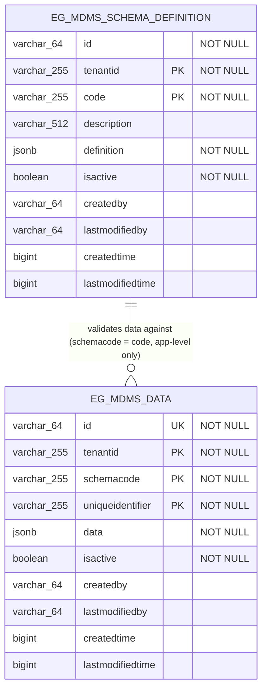

# Master Data Management service

Master Data Management Service is a core service that is made available on the DIGIT platform.  It encapsulates the functionality surrounding Master Data Management.  The service fetches Master Data pertaining to different modules. The functionality is exposed via REST API.

### DB UML Diagram

MDMS V2 persists to two Postgres tables (see `src/main/resources/db/migration/main/`). There is no enforced foreign key between them - `eg_mdms_data.schemacode` is only logically validated against `eg_mdms_schema_definition.code` at the application layer (schema validation on create/update), not via a DB constraint.



- `eg_mdms_schema_definition` - one row per registered JSON schema, keyed by `(tenantid, code)`. `definition` holds the JSON schema used to validate master data.
- `eg_mdms_data` - one row per master data record, keyed by `(tenantid, schemacode, uniqueidentifier)`, with a separate unique `id` (UUID) used as the external identifier in `/v2/_update/{schemaCode}` requests. `data` holds the actual master data payload.
- `eg_mdms_schema_definition_history` / `eg_mdms_data_history` - append-only version history, see [Version History](#version-history).

### Service Dependencies
- NA

### Swagger API Contract

Please refer to the  below Swagger API contarct for MDMS service to understand the structure of APIs and to have visualization of all internal APIs.
http://editor.swagger.io/?url=https://raw.githubusercontent.com/egovernments/egov-services/master/docs/mdms/contract/v1-0-0.yml#!/

For the MDMS V2 APIs (schema `/mdms-v2/schema/v1/_create`, `_search`, `_update` and master data `/mdms-v2/v2/_search`, `_count`, `_create`, `_update`), refer to the contract checked into this repo:
[`core-services/docs/mdms-v2-contract.yml`](../docs/mdms-v2-contract.yml). It can be pasted into http://editor.swagger.io/ for a visual walkthrough of the requests/responses.


## Service Details

The MDM service reads the data from a set of JSON files from a pre-specified location. It can either be an online location (readable JSON files from online) or offline (JSON files stored in local memory). The JSON files should conform to a  prescribed format. The data is stored in a map and tenantID of the file serves as a key. 
Once the data is stored in the map the same can be retrieved by making an API request to the MDM service. Filters can be applied in the request to retrieve data based on the existing fields of JSON.

#### Master data management files check in location and details -

1. Data folder parallel to docs (https://github.com/egovernments/egov-mdms-data/tree/master/data/pb). 
2. Under data folder there will be a folder `<state>` which is a state specific master folder.
3. Under `<state>` folder there will `<tenant>` folders where ulb specific master data will be checked in. for example `pb.testing`
4. Each module will have one file each for statewise and ulb wise master data. Keep the file name as module name itself.

### Sample Config

Each master has three key parameters `tenantId`, `moduleName`, `masterName`. A sample master would look like below

```json
{
  "tenantId": "pb",
  "moduleName": "common-masters",
  "OwnerType": [
    {
      "code": "FREEDOMFIGHTER",
      "active": true
    },
    {
      "code": "WIDOW",
      "active": true
    },
    {
      "code": "HANDICAPPED",
      "active": true
    }
  ]
}
```
Suppose there are huge data to be store in one config file, the data can be store in seperate files. And these seperated config file data can be use under one master name, if `isMergeAllowed`
flag is `true` in [mdms-masters-config.json](https://raw.githubusercontent.com/egovernments/punjab-mdms-data/UAT/mdms-masters-config.json)
### API Details

`BasePath` /mdms/v1/[API endpoint]

#### Method
a) `POST /_search`

This method fetches a list of masters for a specified module and tenantId.
- `MDMSCriteriaReq (mdms request)` : Request Info + MdmsCriteria — Details of module and master which need to be searched using MDMS.

- `MdmsCriteria`

    | Input Field                               | Description                                                       | Mandatory  |   Data Type      |
    | ----------------------------------------- | ------------------------------------------------------------------| -----------|------------------|
    | `tenantId`                                | Unique id for a tenant.                                           | Yes        | String           |
    | `moduleDetails`                           | module for which master data is required                          | Yes        | String           |

- `MdmsResponse`  Response Info + Mdms

- `Mdms`

    | Input Field                               | Description                                                       | Mandatory  |   Data Type      |
    | ----------------------------------------- | ------------------------------------------------------------------| -----------|------------------|
    | `mdms`                                    | Array of modules                                                  | Yes        | String           |

### MDMS V2 API Details

`BasePath` /mdms-v2/v2/[API endpoint]

Full contract: [`core-services/docs/mdms-v2-contract.yml`](../docs/mdms-v2-contract.yml)

#### Method
a) `POST /_search`

Fetches master data matching a `MdmsCriteria` (with tenant-level fallback and offset/limit pagination). Request: `MdmsCriteriaReqV2` (RequestInfo + MdmsCriteria). Response: `MdmsResponseV2` (ResponseInfo + list of `mdms`).

b) `POST /_count`

Returns the total number of master data records matching a `MdmsCriteria`, without fetching the records. It accepts **the exact same request contract as `/_search`** (`MdmsCriteriaReqV2`/`MdmsCriteria`) — offset/limit are ignored — and resolves the tenant-fallback chain identically to `/_search`, so the returned `totalCount` always corresponds to the same tenant tier that `/_search` would return data from for the same criteria.

- `MdmsCriteriaReqV2` : RequestInfo + MdmsCriteria (same model used by `/_search`)

- `MdmsCriteria`

    | Input Field                               | Description                                                                    | Mandatory  |   Data Type            |
    | ----------------------------------------- | -------------------------------------------------------------------------------| -----------|------------------------|
    | `tenantId`                                | Unique id for a tenant. Falls back to parent tenants if no match is found.     | Yes        | String                 |
    | `ids`                                     | List of master data ids to filter by.                                          | No         | Set of String          |
    | `uniqueIdentifiers`                       | List of business unique identifiers to filter by.                              | No         | Set of String          |
    | `schemaCode`                              | Schema code to filter master data by.                                          | No         | String                 |
    | `filters`                                 | Key-value filters applied against the JSON data payload.                       | No         | Map of String to String|
    | `isActive`                                | Filter master data by active/inactive status.                                  | No         | Boolean                |
    | `offset`                                  | Number of records to skip. Ignored by `/_count`.                               | No         | Integer                |
    | `limit`                                   | Maximum number of records to return. Ignored by `/_count`.                     | No         | Integer                |

- `MdmsCountResponseV2` : ResponseInfo + totalCount

    | Input Field                               | Description                                                       | Mandatory  |   Data Type      |
    | ----------------------------------------- | ------------------------------------------------------------------| -----------|------------------|
    | `totalCount`                              | Total number of master data records matching the given criteria.  | Yes        | Long             |

c) `POST /_create/{schemaCode}`

Creates a new master data record, validated against the JSON schema identified by `schemaCode`. Request/Response: `MdmsRequest` / `MdmsResponseV2`.

d) `POST /_update/{schemaCode}`

Updates an existing master data record, re-validated against the JSON schema identified by `schemaCode`. Request/Response: `MdmsRequest` / `MdmsResponseV2`.

e) `POST /mdms-v2/data/history/_search` (full path; it is not under the `/v2` base path)

Returns the recorded versions of master data, latest change first. `tenantId` and `schemaCode` are mandatory. `tenantId` is matched exactly (no tenant fallback). Request: `MdmsHistorySearchRequest` (RequestInfo + MdmsHistoryCriteria). Response: `MdmsHistoryResponse` (ResponseInfo + `mdmsHistory`). Each entry has `changeDetails` (historyId, version, operation, changedTime, dbUser, clientAddress, applicationName, transactionId) and `mdms` (the record as it was after that change).

- `MdmsHistoryCriteria`

    | Input Field          | Description                                                          | Mandatory  |   Data Type    |
    | -------------------- | -------------------------------------------------------------------- | -----------|----------------|
    | `tenantId`           | Tenant the record is stored against (exact match).                   | Yes        | String         |
    | `schemaCode`         | Schema code.                                                         | Yes        | String         |
    | `uniqueIdentifiers`  | Business unique identifiers (max 64).                                | No         | Set of String  |
    | `ids`                | Master data ids (max 64).                                            | No         | Set of String  |
    | `fromTime`/`toTime`  | Change time range, epoch milliseconds, inclusive.                    | No         | Long           |
    | `offset`/`limit`     | Pagination. `limit` must be 1 to `mdms.history.max.limit` (100).    | No         | Integer        |

`POST /mdms-v2/schema/history/_search` works the same way for schemas: `SchemaDefHistorySearchRequest` (RequestInfo + SchemaDefHistoryCriteria with `tenantId`, `codes`, `fromTime`, `toTime`, `offset`, `limit`). `tenantId` and `codes` (at least one, no blank values) are mandatory. The tenant is resolved to the state level, as in schema search.

### Version History

Every change to `eg_mdms_schema_definition` and `eg_mdms_data` is copied into `eg_mdms_schema_definition_history` and `eg_mdms_data_history` by database triggers, in the same transaction as the change. This covers every writer: the persister (API), seed or fix scripts and manual SQL. The migration `V20261114120000__mdms_history_ddl.sql` records every existing row as version 1 with operation `MIGRATION`.

- `operation`: `MIGRATION`, `INSERT`, `UPDATE`, `DELETE` (the row as it was before deletion) or `TRUNCATE` (every row as it was before the truncate). Updates that change nothing are not recorded. An update that changes the key (`tenantid`/`code`, or `tenantid`/`schemacode`/`uniqueidentifier`) is recorded as `DELETE` of the old key plus `INSERT` of the new key.
- `version`: 1, 2, 3 ... per key. It continues if a key is deleted and created again.
- Who made the change: `auditDetails.lastModifiedBy` is the DIGIT user for API writes. Direct SQL usually leaves it unchanged, so use `dbUser`, `clientAddress` and `applicationName`. Start any script or manual session with `SET application_name = '<script-or-ticket>';` so its changes can be identified.
- Restore is a manual procedure, described under [Restoring a version](#restoring-a-version).
- The history tables are append-only. `UPDATE`, `DELETE` and `TRUNCATE` on them are rejected by `trg_eg_mdms_*_history_immutable`. A plain `INSERT` into a history table is rejected by `trg_eg_mdms_*_history_insert_guard`. This only prevents accidental inserts. It is not a security boundary, because the table owner can still bypass it, for example by disabling triggers. The real protection is separate database roles (see below).
- The trigger functions are `SECURITY DEFINER` and owned by the migration user. Any role that can write the main tables can therefore write history without extra grants, and write access to the history tables can be revoked from application roles. Their `search_path` is fixed to `pg_catalog`, then the schema the migration ran in, then `pg_temp`, and every function and operator inside them is schema-qualified. On central instance, where the migration runs once per tenant schema, each schema's triggers write only to that schema's history. A temporary table with the same name, or a planted operator or function, cannot redirect the write or run with the owner's privileges. This still relies on the role setup below: the function owner must not be a superuser, and untrusted roles must not be able to create objects in the MDMS schema.
- Under `REPEATABLE READ`/`SERIALIZABLE`, two transactions changing the same key at the same time can conflict on the version number. The later one fails with SQLSTATE `40001` (serialization failure) and should be retried. The default `READ COMMITTED`, which the persister uses, is not affected.
- Cost: reads (`_search`, `_count`) are not affected. Each changed row adds one small insert, about 0.1–0.5 ms. With many concurrent writers the maximum write throughput roughly halves. Bulk statements in scripts are much slower; in testing, a 100k-row `UPDATE` went from about 1.4 s to 7.3 s and a 100k-row `DELETE` from 0.14 s to about 6 s. History takes about 1–1.15 times the storage of the main table on day one, then grows by one full row copy per change.
- Migration: it blocks writes, not reads, on the two MDMS tables while existing rows are copied (about 15 s per million rows). It sets `lock_timeout = 10s`, so if a long-running transaction holds the tables it fails and rolls back instead of holding every writer. The timeout only limits waiting for the lock; once it holds the lock, writers wait until the copy finishes. Run it in a quiet window.
- Telling the persister apart from scripts: set `ApplicationName=egov-persister` in the persister's JDBC URL. Otherwise its changes show the driver default `PostgreSQL JDBC Driver`.
- Not captured: changes made with triggers disabled (`ALTER TABLE ... DISABLE TRIGGER`, `session_replication_role = replica`, `pg_restore --disable-triggers`). All of these need owner or superuser rights.
- Schema changes to the main tables: the trigger functions reference columns by name. Dropping or renaming a column without updating the history table and trigger functions in the same migration makes every write to that table fail. A new column is not captured until it is added to both.
- Data-only restores or environment copies: copying rows into the main tables creates new history rows, and copying into the history tables is rejected. Use `pg_restore --data-only --disable-triggers` when the history tables must be copied as they are. A full restore is not affected.
- Retention: history is never purged automatically. A purge must be a planned change by the table owner, who has to disable `trg_eg_mdms_*_history_immutable` while doing it.

Protection from bypass and tampering depends on database roles. The tables and trigger functions should be owned by a dedicated owner role that is not a superuser, and the service and persister should connect with a separate application role. If the application role is the owner, these grants have no effect, and anyone with the application credentials can bypass history. When the application role is not the owner, run the following as the owner. The `GRANT SELECT` is **required**; without it the history search APIs fail with `permission denied`.
```sql
-- On PG <= 14 every role can create objects in schema public by default
REVOKE CREATE ON SCHEMA <mdms_schema> FROM PUBLIC;
REVOKE TRUNCATE ON eg_mdms_data, eg_mdms_schema_definition FROM <app_role>;
REVOKE INSERT, UPDATE, DELETE, TRUNCATE ON eg_mdms_data_history, eg_mdms_schema_definition_history FROM <app_role>;
GRANT SELECT ON eg_mdms_data_history, eg_mdms_schema_definition_history TO <app_role>;
```

#### Restoring a version

There is no restore API. Restore is a manual procedure.

- **Master data, record still exists:** take `mdms.data` from the required version in `/mdms-v2/data/history/_search`. Send it to `/v2/_update/{schemaCode}` with the current record's `id` and `auditDetails`. The restore is recorded as a new version.
- **Master data, record deleted:** send the old `data` to `/v2/_create/{schemaCode}`.
- **Limits of the API path:**
  - The old data is validated against the *current* schema, so a version that no longer matches the schema cannot be restored this way.
  - A key change made by SQL (recorded as `DELETE` + `INSERT`) cannot be reverted, because `_update` does not allow changing unique fields.
  - In both cases, restore with SQL as shown below.
- **SQL restore checks:** `UPDATE` reports how many rows it changed. Check that it is `UPDATE 1`. `UPDATE 0` means nothing matched and nothing was restored.
- **Schemas:** `/schema/v1/_update` is not implemented, so a schema is restored with SQL. Set `application_name` first so the restore can be identified in history:
```sql
SET application_name = 'restore-<ticket>';
UPDATE eg_mdms_schema_definition s
   SET definition = h.definition, description = h.description, isactive = h.isactive,
       lastmodifiedby = '<user-uuid>', lastmodifiedtime = (EXTRACT(EPOCH FROM now()) * 1000)::BIGINT
  FROM eg_mdms_schema_definition_history h
 WHERE h.tenantid = s.tenantid AND h.code = s.code
   AND s.tenantid = '<tenant>' AND s.code = '<code>' AND h.version = <version>;
```
  Master data whose key did not change is restored with SQL in the same way, from `eg_mdms_data_history`, matching on `tenantid`, `schemacode` and `uniqueidentifier`.
- **Master data whose key was changed by SQL:** the current row has the new key, so matching on the old key finds nothing. Match on the record `id` instead, and take the old key's version (usually the `DELETE` row written by the key change). The restore is recorded as `DELETE` of the new key plus `INSERT` of the old key. If another record already uses the old key, the `UPDATE` fails with a primary-key error and nothing changes.
```sql
SET application_name = 'restore-<ticket>';
UPDATE eg_mdms_data s
   SET tenantid = h.tenantid, schemacode = h.schemacode, uniqueidentifier = h.uniqueidentifier,
       data = h.data, isactive = h.isactive,
       lastmodifiedby = '<user-uuid>', lastmodifiedtime = (EXTRACT(EPOCH FROM now()) * 1000)::BIGINT
  FROM eg_mdms_data_history h
 WHERE s.id = h.id
   AND h.tenantid = '<tenant>' AND h.schemacode = '<schemaCode>' AND h.uniqueidentifier = '<old-key>'
   AND h.version = <version>;
```

Gateway: add `/mdms-v2/data/history/_search` and `/mdms-v2/schema/history/_search` to the access-control actions and map them only to admin roles. The response includes database session details (`dbUser`, `clientAddress`).

### Kafka Consumers

- NA

### Kafka Producers

- NA